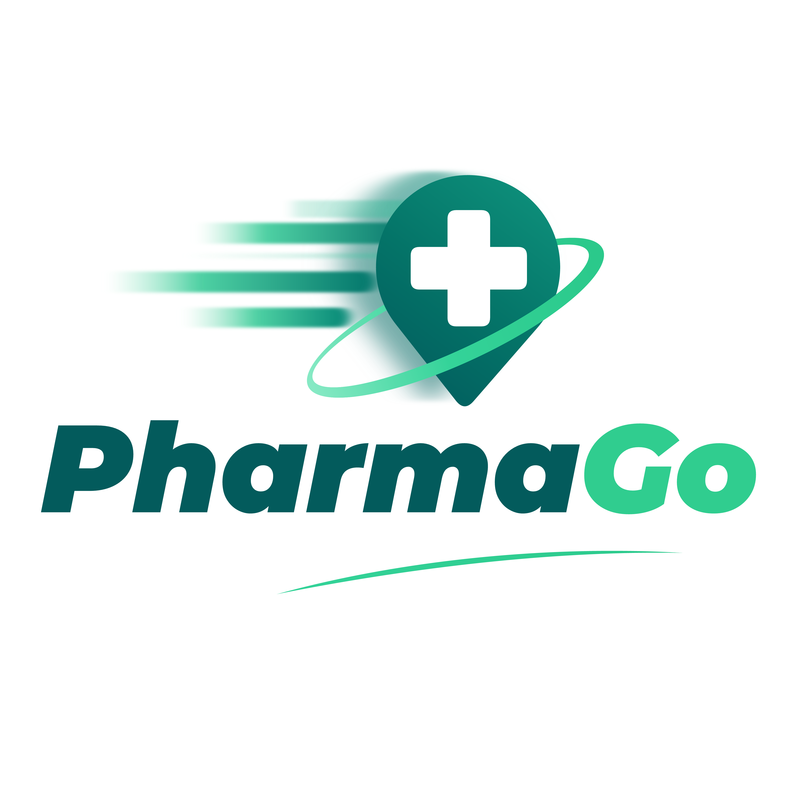

<p align="center">
  
</p>

PharmaGo es una app móvil que te ayuda a encontrar tus medicamentos en farmacias independientes de Chile. Te muestra cuál tiene stock, cuál te queda más cerca y cómo llegar más rápido.

Es el proyecto de la asignatura Capstone (APT) de Ingeniería en Informática en DuocUC.

## Por qué lo hicimos

Las farmacias de cadena concentran cerca del 85% de las ventas, pero las farmacias independientes son alrededor del 50% de los locales y muchas veces tienen los medicamentos a menor precio. El problema es que hoy no existe una herramienta simple para que una persona pueda buscar en ellas. PharmaGo intenta resolver eso.

## Qué hace

- Buscador de medicamentos con validación de stock.
- Indica la farmacia independiente más cercana que tiene el producto.
- Muestra la ruta más rápida para llegar.
- Escáner de receta médica con IA: se sube o se escanea el documento y la app lee los medicamentos.
- Historial de recetas y búsquedas.
- Alertas de stock.
- Sugiere un bioequivalente si la marca que buscas no está disponible (siempre con el aviso de consultar a un farmacéutico).
- Si ninguna farmacia tiene todos los medicamentos, arma una ruta con las farmacias más cercanas entre sí.
- Pensada para ser accesible.

## Tecnologías

- Frontend: React y Leaflet para los mapas
- Backend: (completar)
- Base de datos: MongoDB
- OCR para leer las recetas
- Herramientas: GitHub, Postman, MongoDB Compass y Trello

## Estructura del repositorio

```
CAPSTONE/
├── CAPSTONE/    # código del proyecto
└── README.md
```

(completar con las subcarpetas)

## Cómo correrlo

```bash
git clone https://github.com/IMarcuSI/CAPSTONE.git
cd CAPSTONE/CAPSTONE
npm install
npm start
```

Si el proyecto usa variables de entorno (URI de MongoDB, claves, etc.), hay que crear un archivo `.env` antes de ejecutar.

## Estado actual

- [x] Esqueleto de la app
- [x] Carga de datos de prueba (con datos reales de una farmacia)
- [ ] Resto del backlog (PGOD-001 a PGOD-020)

## Equipo

- Marcelo Zamora: PM y desarrollo full-stack (backend y arquitectura)
- Nicolás Gómez: frontend (React, Leaflet, UI/UX y accesibilidad)
- Elías Esbeiler: apoyo en ML y backend (OCR, MongoDB, APIs y deployment)

## Cómo trabajamos

Usamos una metodología ágil adaptada a lo académico, con 12 sprints en 3 meses. Nos juntamos los miércoles después de clases y nos coordinamos por GitHub y Discord.

## Aviso

PharmaGo no reemplaza la opinión de un profesional de la salud. Los bioequivalentes que sugiere son solo una referencia, siempre hay que consultar a un químico farmacéutico.
